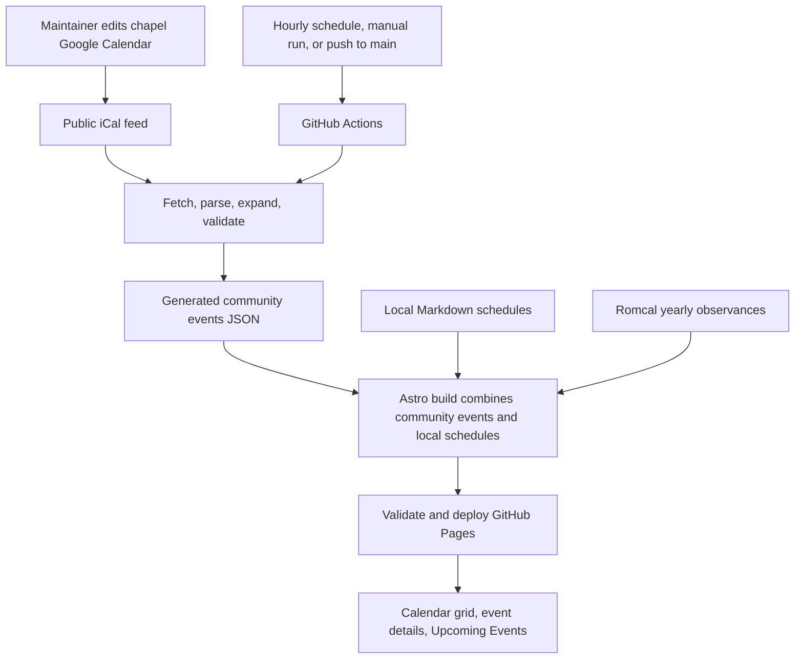

# Google Calendar community events sync

**Status:** Proposed design; no implementation or account configuration performed.

**Site:** Rosarium — Our Lady of the Most Holy Rosary Chapel, Jubilation Enclave North, Biñan, Laguna.

## Purpose and decisions

Let chapel maintainers create, edit, reschedule, and cancel community activities in Google Calendar. Publish those activities in Rosarium's existing calendar and Upcoming Events panel through generated JSON, without editing Markdown for each activity.

The user selected automatic syncing and requested this design before implementation. The public iCal feed, hourly schedule, import window, and failure policy below are recommended defaults for review. No Google calendar URL has been supplied yet.

Keep the existing mobile and desktop layouts, Philippine Time, seven-day Upcoming Events rule, local chapel schedules, and Romcal observances. Visitors continue browsing a static site without a Google account. Private calendar integration, editing events from Rosarium, immediate push updates, and replacing Romcal are outside this version.

## Approaches considered

| Approach                                             | Benefits                                                                       | Tradeoffs                                                                                                                      |
| ---------------------------------------------------- | ------------------------------------------------------------------------------ | ------------------------------------------------------------------------------------------------------------------------------ |
| Public iCal feed → normalized JSON during deployment | No Google API credentials; familiar Google Calendar editing; fits GitHub Pages | Requires a public calendar; importer must correctly expand recurrence and exceptions; publication follows the refresh schedule |
| Google Calendar API → JSON during deployment         | Structured data; Google can expand recurring instances                         | Additional Google Cloud/API setup and credential management                                                                    |
| Manual calendar export → JSON                        | Simple operational model                                                       | Repeated manual exports and deployments; does not meet the selected automatic-sync requirement                                 |

**Recommendation:** Public iCal import during the existing GitHub Pages deployment. Use a dedicated public calendar containing only chapel activities intended for publication. Google documents the public iCal address under **Integrate calendar**; the calendar must be public for that feed to work. [Google instructions](https://support.google.com/calendar/answer/37083?hl=en)

Do not use the personal calendar's secret iCal address. Google explicitly says that address should not be shared. [Calendar address guidance](https://support.google.com/calendar/answer/37648?hl=en)

## Data flow



Fetch Google only in the build workflow, once per run. Site visitors request Rosarium's own assets; they do not contact Google to load event data. A fresh deployment publishes one consistent event snapshot.

Generated JSON is a deployment artifact, not an automatically committed source file. The workflow retains its current read-only repository permissions; it does not push commits or create hourly Git history.

## Sources and ownership

| Source                    | Responsibility                                                                              |
| ------------------------- | ------------------------------------------------------------------------------------------- |
| Romcal                    | Solemnities, feasts, obligatory memorials, and existing seasonal markers                    |
| `src/content/events/`     | Existing Sunday Mass, Simbang Gabi, Christmas Eve Mass, Rosary novena, and chapel feast day |
| Dedicated Google Calendar | Additional community events such as choir rehearsals, meetings, outreach, and gatherings    |

Each activity should have one owning source. Do not copy the existing Mass schedules or Romcal observances into Google Calendar during initial setup. Google imports do not automatically override a local event merely because titles or dates match. Cancellation in Google affects only the imported activity, not a separately authored local Mass.

Migrating the recurring Mass schedules into Google would be separate work: the existing Sunday exclusion during Simbang Gabi must be preserved explicitly.

## Proposed files and integration points

These paths describe future implementation; only this design document is being added now.

| File                                           | Intended role                                                                                                              |
| ---------------------------------------------- | -------------------------------------------------------------------------------------------------------------------------- |
| `src/config/community-calendar.json`           | Enable flag, display name, import window, default category, and reviewed ID-to-category overrides; no credentials          |
| `src/lib/community-calendar.mjs`               | Fetch, parse, normalize, validate, and expose imported events through a shared build-time loader                           |
| `src/pages/calendar-data/community.json.ts`    | Emit the normalized snapshot as static JSON using the same loader                                                          |
| `src/layouts/components/ChapelCalendar.astro`  | Combine imported records with local records; embed the snapshot and include imported entries in the no-JavaScript fallback |
| `src/lib/calendar.mjs`                         | Preserve existing recurrence and seven-day behavior; add imported end-time metadata only where necessary                   |
| `src/lib/calendar-client.ts`                   | Display imported descriptions and optional end times; show snapshot freshness information                                  |
| `src/styles/calendar.css`                      | Style the small freshness notice consistently in light and dark modes                                                      |
| `.github/workflows/deploy-to-github-pages.yml` | Add schedule and pass feed configuration into the build                                                                    |
| `tests/community-calendar*.mjs`                | Import fixtures, recurrence/time-zone tests, and actual calendar integration checks                                        |
| `docs/managing-events.md`, `README.md`         | Document ownership, setup, routine maintenance, and recovery                                                               |

Use a maintained iCalendar parser/recurrence library with a pinned version selected during implementation. Do not parse ICS with ad hoc regular expressions. Verify support for the Google feed fixtures and the recurrence cases below before choosing the dependency.

## JSON contract

Proposed endpoint: `/calendar-data/community.json`.

```json
{
  "schema_version": 1,
  "source": "google-calendar",
  "calendar_name": "Chapel Community Events",
  "time_zone": "Asia/Manila",
  "last_successful_sync": "2026-11-01T02:17:00Z",
  "coverage_start": "2025-01-01",
  "coverage_end_exclusive": "2028-01-01",
  "events": [
    {
      "id": "gcal-example-stable-occurrence-id",
      "title": "Choir rehearsal",
      "description": "Practice for Sunday's Mass.",
      "location": "Our Lady of the Most Holy Rosary Chapel",
      "category": "general",
      "date": "2026-11-07",
      "end_date": "",
      "time": "18:00",
      "all_day": false,
      "repeat": "none",
      "excluded_dates": [],
      "start_at": "2026-11-07T18:00:00+08:00",
      "end_at": "2026-11-07T19:30:00+08:00",
      "source": "google-calendar"
    }
  ]
}
```

The sample is illustrative, not a confirmed chapel rehearsal. Imported records use existing calendar fields wherever possible. `start_at` and `end_at` are additional metadata for accurate details; they do not change the current rule that an event stops being upcoming after its start time passes.

Generate stable IDs from the calendar identity, event UID, and original recurrence identity. A moved recurrence retains its identity. Namespace imported IDs to avoid collisions with local Markdown IDs. Do not expose raw feed URLs, attendee emails, organizer emails, conference access details, or other unused feed fields in JSON or logs.

Descriptions are converted to plain text with paragraph breaks. Render them as text, preserving line breaks; never insert arbitrary feed HTML into the event dialog. Imported events should have equivalent expandable details in the no-JavaScript fallback.

## Import and display rules

1. **Coverage:** Import the previous, current, and following calendar years, based on the year in Manila. On November 1, 2026, coverage is January 1, 2025 through December 31, 2027. Include events overlapping the window, not just events starting inside it. Refresh the window automatically in January. Years outside this window retain local/Romcal content; a brief note makes clear that Google community events have limited coverage. This is not a permanent historical archive.
2. **Time zones:** Honor UTC values, explicit `TZID`, and Google calendar time-zone definitions; convert timed starts and ends to `Asia/Manila`. Interpret floating timed values using the declared source calendar time zone; fail validation if no unambiguous source zone can be established. Keep all-day dates as dates without converting them through UTC.
3. **Timed events:** Show a marker on their Manila start date, with start/end information in details. Overnight or multi-day timed events are one scheduled occurrence, not a newly starting event on every day. Preserve end timestamps without feeding an inclusive date range into the existing daily expansion logic.
4. **All-day entries:** Set `all_day: true`; show calendar markers and details, never Upcoming Events. iCalendar all-day end dates are exclusive; convert them to the inclusive last date required by the existing grid. A November 7–9 exclusive range marks November 7 and 8 only. [iCalendar specification](https://www.rfc-editor.org/rfc/rfc5545)
5. **Recurrence:** Expand recurring events into concrete occurrences within the bounded import window. Apply `RRULE`, `RDATE`, `EXDATE`, detached `RECURRENCE-ID` changes, and cancellations before normalization. Handle “this and following” Google exports, including split series or supported range exceptions. If the chosen parser cannot interpret a construct, fail with an actionable error rather than silently publishing incorrect dates. Bound expansion time and occurrence counts.
6. **Edits/deletions:** Replace the entire imported snapshot on each successful sync. Events absent from a valid new feed disappear; canceled series and canceled individual instances are excluded. No incremental append-only merge that leaves canceled activities behind.
7. **Categories:** Default imported activities to the existing `general` icon. Optional source-event ID overrides in site configuration can assign existing categories such as `mass` or `novena`. Do not infer Mass or liturgical rank from title words, Google event colors, or all-day status. No new icon set is needed for the initial release.
8. **Upcoming Events:** Merge local and imported timed activities, then apply the existing Manila-based rule: today plus six days, excluding elapsed start times. The displayed month does not affect this list. All-day markers remain excluded.
9. **Empty versus broken:** A successfully parsed, complete public calendar with zero eligible events is a valid empty result and removes previous imported activities. A network error, HTML login page, truncated feed, unsupported recurrence, or invalid required field is an import failure; it must not be treated as an empty calendar.

## Workflow and freshness

Extend the existing deployment workflow rather than adding an independently deploying workflow. Keep deployment concurrency serialized with the existing `cancel-in-progress: false` setting.

- Run on pushes to `main`, manual **Run workflow**, and a proposed hourly cron of `17 * * * *` (minute 17, avoiding the busiest top-of-hour period).
- Set a GitHub repository Actions variable named `COMMUNITY_CALENDAR_ICS_URL` to the dedicated calendar's **Public address in iCal format**. It is a public URL; OAuth, a Google API key, and a service account are not required for this approach.
- An enabled import with a missing URL is a configuration error. Do not silently publish zero imported events.
- Fetch with a timeout and limited retries, then validate the complete snapshot before building/publishing. Treat snapshot construction as atomic.
- Generate JSON, embed the same records into the Calendar page, run required checks, build, and use the existing Pages artifact/deploy steps.
- The initial version rebuilds and deploys on each scheduled run, even if content is unchanged. This is simpler and keeps the last-successful-sync timestamp accurate. Monitor runner usage and deployment duration; content-change detection can be a later optimization.
- Show a small “Community events last synced … PHT” notice. After 24 hours, add a plain-language stale-data notice. This timestamp describes the last successful feed retrieval, not proof that Google has already reflected every edit.
- Existing open pages show their loaded snapshot until refreshed. No live polling is proposed.

Hourly is a target, not a guaranteed one-hour publication deadline: Google feed availability, workflow queueing, build time, deployment, and caching contribute to delay. GitHub says schedules may be delayed or dropped and public-repository schedules can be disabled after 60 days without repository activity. The maintainer must monitor this and re-enable the workflow if needed. [GitHub schedule documentation](https://docs.github.com/en/actions/reference/workflows-and-actions/events-that-trigger-workflows#schedule)

## Failures and recovery

If an enabled import fails, fail the build before deployment. GitHub Pages retains the last successful deployment, including its previous JSON and timestamp. Do not substitute an empty snapshot, publish partial records, or mark old data as freshly synced.

This policy deliberately blocks unrelated source deployments during a feed outage. Recovery options are to fix the feed and rerun the workflow, or disable the integration in site configuration and deploy local/Romcal content only. A future persistent last-good snapshot could relax this dependency; it is not part of this design.

Report success/failure and imported occurrence counts in the Actions job summary. Rely on the maintainer's GitHub Actions notification settings for failure notification; no new email/messaging integration is proposed.

## Setup steps for the chapel maintainer

### 1. Prepare Google Calendar

1. Create a separate calendar named **Chapel Community Events** using the account responsible for chapel scheduling.
2. Set its time zone to **Asia/Manila**. Give the relevant chapel maintainers editing access.
3. On desktop, open **Settings → Settings for my calendars → Chapel Community Events → Access permissions for events**.
4. Enable **Make available to public**, with **See all event details**. Free/busy-only access cannot supply usable titles and descriptions. An organization administrator may restrict public sharing. [Google sharing instructions](https://support.google.com/calendar/answer/37083?hl=en)
5. Under **Integrate calendar**, copy **Public address in iCal format**. Do not copy the browser page URL, embed code, or secret address.
6. Confirm the public feed can be downloaded without signing in. Add clearly labeled temporary test entries: a timed event, an all-day marker, and a weekly rehearsal with one moved/canceled occurrence. Remove these tests before production activation.
7. Publish only details intended for neighbors to see. Create each new activity in the dedicated calendar rather than a personal calendar.

### 2. Configure GitHub after implementation

1. Open the repository's **Settings → Secrets and variables → Actions → Variables**.
2. Add `COMMUNITY_CALENDAR_ICS_URL` containing the public iCal URL.
3. Review the import window and category overrides in the new site configuration; enable syncing.
4. Merge/push the approved implementation to `main`. The schedule only runs from the default branch.
5. Open **Actions → Deploy Astro site to GitHub Pages → Run workflow** for an initial controlled sync.
6. Confirm import counts and coverage in the job summary, then verify both the JSON endpoint and the live Calendar page.
7. Edit, reschedule, and cancel test events; run the workflow manually after each change and confirm the site reflects them. Check phone and desktop layouts in light and dark modes.
8. Remove temporary test entries, run a final sync, and leave the hourly schedule enabled.

### 3. Routine management

- Maintain additional community activities in Google Calendar; no JSON editing or source commit is needed for each event.
- Set a time for gatherings. Use the **All day** option only for calendar markers, following the chapel's current rule.
- Make recurring-event changes using Google's occurrence/series controls. Check the next published snapshot after changing an exception.
- For a faster refresh, run the deployment workflow manually. Check the sync timestamp and Actions results if an update appears delayed.
- Continue managing the existing chapel Mass schedules in Markdown and liturgical markers through Romcal.

## Implementation sequence for later approval

1. Capture representative public Google feed samples and select a parser after validating recurrence/time-zone support.
2. Implement and test a pure normalization layer using saved fixtures and a fixed test clock.
3. Add bounded fetching, source configuration, validation, and the shared snapshot loader; generate the JSON endpoint.
4. Merge imported records into the existing calendar and fallback details; add end-time and freshness display without changing the seven-day rule.
5. Add the hourly trigger and variable to the existing workflow, preserving Pages permissions and concurrency.
6. Update the README and event-management guide, including local development: use an explicit offline fixture mode or disabled integration; never silently replace a failed enabled import with fixtures. Clearly label fixture data as preview-only and prohibit it in production builds.
7. Run the validation below, review the diff, then publish only when implementation and account setup are authorized. This design does not authorize deploying code or changing account settings now.

## Acceptance checks

- A Google timed event appears in the correct Manila date cell and in Upcoming Events only when its start falls within the existing seven-day rule.
- UTC, source time zones, midnight boundaries, year rollover, and all-day exclusive ends normalize correctly.
- Recurring activities expand within bounds; moved and canceled instances do not duplicate or remain at their original date/time.
- Deleting an event or all eligible events in a valid calendar removes it/them after a successful deployment.
- Invalid/network responses fail the job without deploying; the previous public site and freshness timestamp remain intact.
- Local schedules, Simbang Gabi Sunday exclusions, Romcal markers, and reading-cycle labels retain their current behavior.
- Imported descriptions cannot execute HTML/scripts; private feed fields and feed URLs are absent from generated output.
- The grid, dialogs, legend, freshness notice, and Upcoming Events work on mobile and desktop in both themes; imported details are present without JavaScript.
- Fixture-based unit tests, calendar integration tests, `pnpm check`, and the production build pass without live Google access. A separate manual live-feed smoke test verifies the actual configured calendar.
- The workflow does not commit generated JSON or require repository write access. Failure notifications and the 60-day schedule limitation are documented for maintainers.

## Decisions to confirm before implementation

The proposed defaults are hourly syncing, a dedicated public calendar, three calendar years of imported coverage, general-category icons, and blocking deployment on import failure. The actual public feed URL is required for activation. Any need for private calendars, a permanent imported-event archive, or updates within minutes would require revisiting this design.
